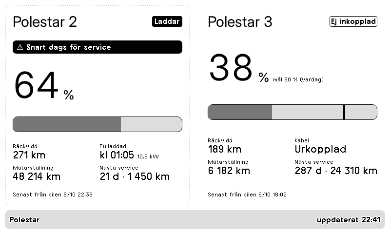

# Polestar – laddstatus

Plugin för [TRMNL](https://trmnl.com) (e-pappersskärm). Batterinivå, räckvidd, laddstatus, när bilen är fulladdad, laddmål, mätarställning, nästa service och varningar för en eller två Polestar-bilar.



Alla fyra layouter (full, half_horizontal, half_vertical, quadrant) finns, så den fungerar i mashups.
Se [`preview/overview.png`](preview/overview.png).

## Installera

**Import:** zippa innehållet i `src/` (platt, inga mappar) och välj TRMNL → Plugins → Private Plugin → **Import new**.

```sh
cd src && zip ../polestar.zip * && cd ..
```

**[trmnlp](https://github.com/usetrmnl/trmnlp):**

```sh
trmnlp login    # en gång
trmnlp push     # laddar upp src/; lägg sedan till id: i src/settings.yml
trmnlp serve    # förhandsvisning på http://localhost:4567 med värdena i .trmnlp.yml
```

## Om

Data skickas till pluginens webhook av `pusher/push.py`, som använder det inofficiella biblioteket [pypolestar](https://github.com/pypolestar/pypolestar). Inofficiell, inte gjord av eller kopplad till Polestar.

### Skriptet

```sh
cd pusher
python3 -m venv .venv && .venv/bin/pip install -r requirements.txt
cp polestar.env.example polestar.env   # Polestar ID + webhook-URL; chmod 600
set -a; . ./polestar.env; set +a; .venv/bin/python push.py
```

Kör det var tionde minut, t.ex. med `polestar-trmnl.service` + `polestar-trmnl.timer` (systemd user units; justera sökvägarna). Det skickar bara när något ändrats, eller minst en gång i timmen, för att hålla sig under TRMNL:s gräns på 12 webhook-anrop per timme. `push_demo.sh <webhook-url>` skickar exempeldata från `preview.json`.

Lås-, dörr- och positionsstatus finns inte i pypolestar.

## Licens

[MIT](LICENSE)
